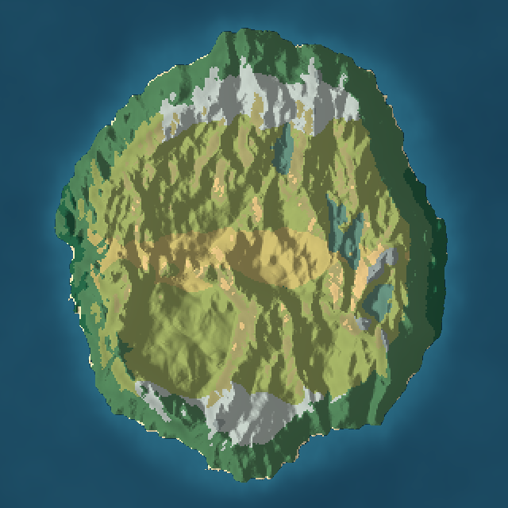
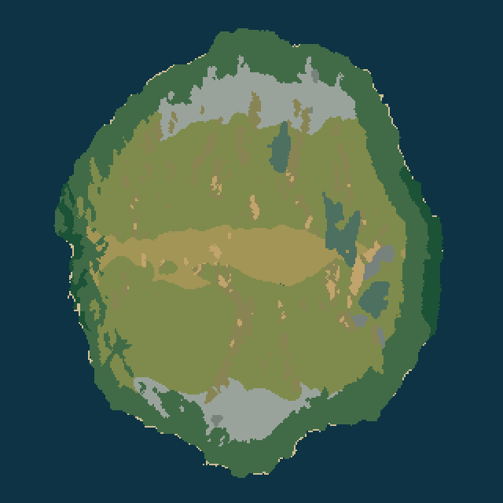
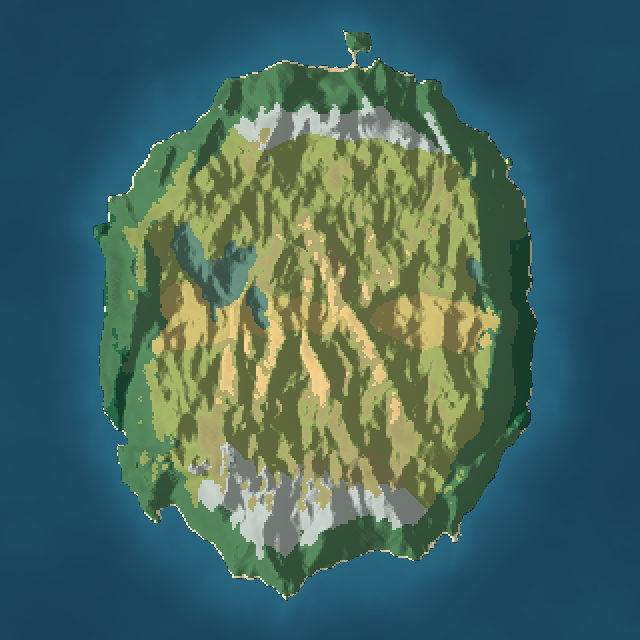
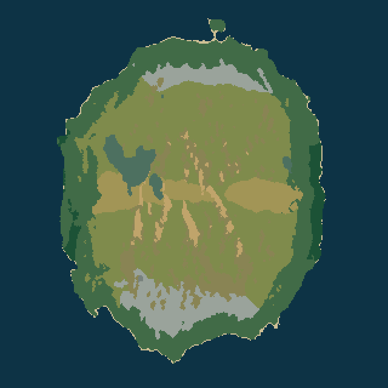

# ARK Map Studio: Ultimate — Procedural World Lab

Deterministic procedural world-generation studio with geological simulation, hydrology, climate, 3D exploration and validated exports. Built as a React 19 + Vite + Three.js desktop web app, packaged as a Windows `.exe`.



## Features

- Seeded, deterministic world generation (height, slope, hydrology, climate, biomes, objects)
- 3D terrain viewport with Three.js (ACES tone mapping, shadows, custom sky)
- Cartographic map canvas overlay
- Editable terrain brushes and asset placement with undo
- Validated exports: 16-bit PNG heightmap, RAW Uint16LE, JSON metadata, ARK bundle
- 18/18 live assertion suite (determinism, hydrology, codec round-trip, disclosure)

## Screenshots

| Preview (seed 577) | Biome map (seed 577) |
|---|---|
|  |  |

| Preview (seed 42) | Biome map (seed 42) |
|---|---|
|  |  |

## Setup

```bash
npm install
npm run dev
```

Open http://localhost:5173.

## Build

```bash
npm run build
npm run electron:build
```

## Desktop (Windows)

A prebuilt Electron executable is produced in `release/ARKMapStudio/`.

## Validation

```bash
npx tsx scripts/verify.ts
```

Expected: `18/18 passed`.

## License

MIT
